  
  
  
  

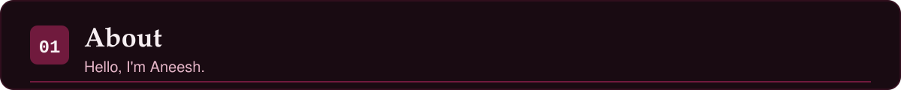

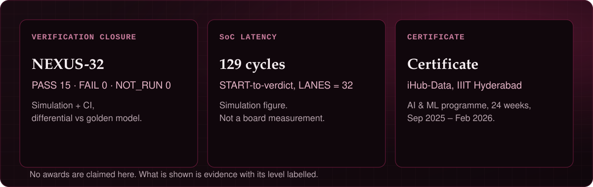

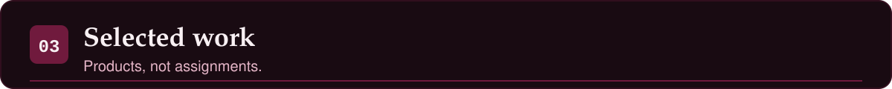

<a href="https://github.com/Aneeshparveda/NEXUS-32">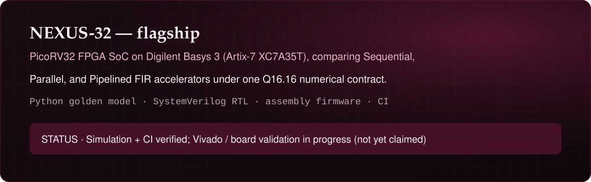</a>

  

<a href="https://github.com/Aneeshparveda/CircuitMind">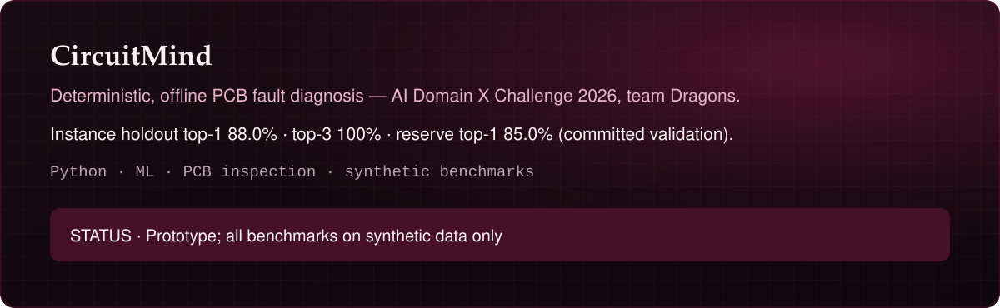</a>

  

<a href="https://github.com/Aneeshparveda/ARIA"></a>

  

<a href="https://github.com/Aneeshparveda/IIITH_ComputerVision_Internship_2026"></a>

  


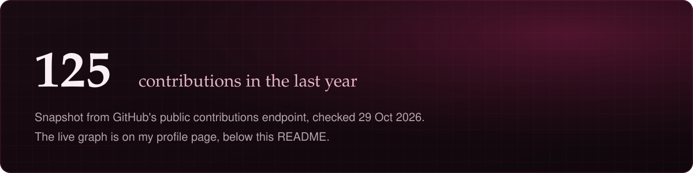

  <em>The panel above is a snapshot from 29 October 2026, not live data, and its grid animation is stylised, not real contribution squares. My live contribution graph is on <a href="https://github.com/Aneeshparveda">my GitHub profile</a>.</em>

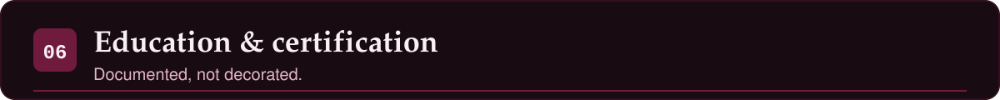
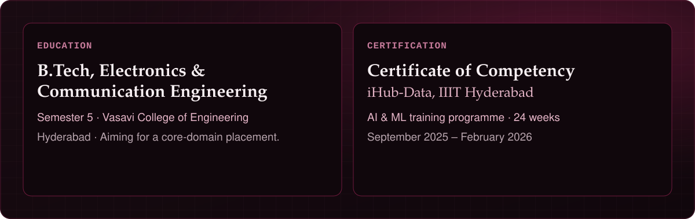


  
  
  

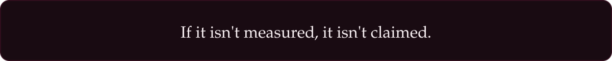

<!--
  Notes for the next editor (not rendered on the profile):
  - No github-readme-stats widget: it returned HTTP 503 for this account on 2026-10-29
    and renders as a broken alt-text link on the reference profile checked the same night.
  - No contribution snake: that needs a GitHub Actions workflow writing the SVG; the
    commit-log panel above is a dated snapshot instead, and says so.
  - No CGPA: not re-verified from a document for this build.
  - No phone number anywhere, by rule.
  - No claims from any other person's profile were copied; only this profile's
    verified facts appear here.
-->
