# Hi, I'm Aneesh Parveda

**FPGA & SoC Designer — B.Tech ECE, Semester 5, Vasavi College of Engineering, Hyderabad. Aiming for a core-domain placement.**

*I build things you can reproduce, re-measure, and defend — simulation evidence first, board evidence when it exists, never claimed early.*

## 🚀 Currently building

### [NEXUS-32](https://github.com/Aneeshparveda/NEXUS-32) — flagship

PicoRV32 FPGA SoC on Digilent Basys 3 (Artix-7 XC7A35T), comparing **Sequential, Parallel, and Pipelined FIR accelerators under one Q16.16 contract**. Python golden model, SystemVerilog RTL, assembly firmware, CI.

> Simulation + CI verified; Vivado/board validation in progress (**not yet claimed**). SoC latency 129 cycles is a simulation figure, not a board measurement.

## 🎓 Verified education & certification

- **B.Tech ECE, Semester 5, Vasavi College of Engineering, Hyderabad**
- **iHub-Data, IIIT Hyderabad — Artificial Intelligence and Machine Learning training programme, 24 weeks, September 2025 – February 2026, Certificate of Competency**

## 📌 Selected projects

| Project | What it is | Honest status |
|---|---|---|
| **[NEXUS-32](https://github.com/Aneeshparveda/NEXUS-32)** | PicoRV32 FIR SoC — 3 architectures, one contract, golden model + CI | Simulation + CI verified; board pending |
| **[CircuitMind](https://github.com/Aneeshparveda/CircuitMind)** | Deterministic, offline PCB fault diagnosis (AI Domain X Challenge 2026, team Dragons) | Prototype; all benchmarks on **synthetic data only** |
| **[IIITH_ComputerVision_Internship_2026](https://github.com/Aneeshparveda/IIITH_ComputerVision_Internship_2026)** | CV internship learning record: YOLO detection, segmentation, dataset engineering, PCB-inspection concept | Learning record, not a library; **no metrics claimed** |
| **[ARIA](https://github.com/Aneeshparveda/ARIA)** | ESP32 + Arduino Uno laser Li-Fi fire/gas alert system (fork of a team project) | College mini-project prototype, **not** a certified safety device |

## 🛠️ Skills, grouped

| Category | Technologies |
|---|---|
| Hardware / SoC | SystemVerilog, Verilog, Vivado, RISC-V |
| Software | Python, C, C++, Arduino |
| AI / Computer Vision | AI, Machine Learning, OpenCV |
| Tools | Git, GitHub |

## 🟫 Contribution graph

*The grid above is a decorative pattern, not activity data. My live contribution graph is on [my GitHub profile](https://github.com/Aneeshparveda).*

<!-- GitHub stats widget omitted: github-readme-stats returned HTTP 503 when checked on 2026-10-29. Re-add only once the service is reachable again; do not substitute invented numbers. -->

## 🧭 Focus areas

- VLSI / SoC design
- RISC-V
- DSP & hardware acceleration
- Robotics
- Edge AI / TinyML

## 📫 Find me

- GitHub: [@Aneeshparveda](https://github.com/Aneeshparveda)
- LinkedIn: [aneeshparveda](https://www.linkedin.com/in/aneeshparveda/)
- Email: [aneeshparveda@gmail.com](mailto:aneeshparveda@gmail.com)
- Flagship project: [NEXUS-32](https://github.com/Aneeshparveda/NEXUS-32)

---

